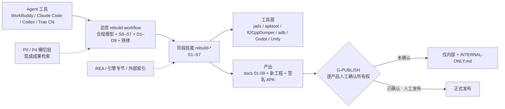

# apk-rebuild-skills

公司内部用的 **AI Agent Skill 包**：把「安装包 → 逆向取证 → 重建 → 再开发 → 交付工程 + 试玩 APK」整套流程固化下来。目标是让任何同事接手这类项目时都按同一套流程、同一套出口标准走，不依赖个人经验。

适用于 WorkBuddy / CodeBuddy / Claude Code / Codex / Trae CN / OpenCode 等支持 `SKILL.md` 的 Agent 工具。当前版本见 [CHANGELOG.md](CHANGELOG.md)（**v1.4.0**）。

> ## ⚠️ 合规模型（v1.4.0 起）
>
> **允许所有作品**（公司自有 / 权属待确认 / 第三方 / 来源未知）进入**分析与重建流程**，权属只做状态登记，不阻断开工。
>
> **正式发布另有人控门禁**：S7 之前必须**逐产品人工确认所有权**，**由人工执行发布**；Agent 不得自动对外发布、上架或分发。未确认时产物一律标 `仅内部`。
>
> 判断口诀：**能不能分析 ≠ 能不能发布**。分析范围仍逐项勾选，没勾 = 不做；全程禁止绕过登录/风控/证书校验、不复用第三方生产服务、不公开发布反编译产物。

## 架构总览（v1.4.0）

完整架构图（分层架构、端到端流程与人机边界、合规两线、外部能力接入位置）见 **[docs/ARCHITECTURE.md](docs/ARCHITECTURE.md)**；阶段级细节见 `skills/rebuild-workflow/references/stage-map.md`。



## 包含的 skill

| Skill | 版本 | 阶段 | 一句话 | 可单独使用 |
|---|---|---|---|---|
| `rebuild-workflow` | 1.4.0 | 总控 S0–S7 | 合规模型、P0/P4 检查点、输入检查表、决策门、出口标准、发布门禁、复盘回写 | 入口 |
| `rebuild-recon` | 1.3.0 | S1–S2 | 解包、引擎识别、REA 方法级证据、docs/01-09 九篇文档 | ✅ 只做分析 |
| `rebuild-asset-recovery` | 1.3.0 | S3 | 资源回导（Godot 全套脚本 + RN 资源/i18n 脚本）、版权审查 | ✅ 只提资源 |
| `rebuild-product-design` | 1.3.0 | S4 | P4 参考实现、产品文档、决策门 D1-D9、品牌、微创新、开发计划 | ✅ 规划新版本 |
| `rebuild-dev-milestones` | 1.1.0 | S5 | M0-M5 里程碑开发与纪律 | ✅ 任何重写项目 |
| `rebuild-device-evidence` | 1.2.0 | S6 | ADB 真机自动化 + 录屏抽帧 + 视觉模型读图 + REA 设备 Evidence 交叉索引 | ✅ 任何真机测试 |
| `rebuild-build-release` | 1.2.0 | S7 | **G-PUBLISH 发布门禁**、打签名 APK、真机冒烟、交付清单 | ✅ 任何 Godot 打包 |

引擎支持（详见 `skills/rebuild-workflow/references/engines/`）：

| 引擎 | 状态 | 案例 |
|---|---|---|
| Godot 4.x | ✅ 全流程验证（S0–S7，含签名 APK） | 项目 D |
| React Native（Expo）+ Hermes | 🟡 S1–S3 + M0 验证（含自研原生模块复原） | 项目 C |
| Unity + IL2CPP | 🟡 S1–S3 + M0 部分验证（Il2CppDumper / UnityPy / CCD 关卡拉取）；可试点 `CoplayDev/unity-mcp` | 项目 F（E 复用） |
| Cocos / 原生等 | 只有模板 `_template.md`，有真实案例再补 | — |

## 现成成果检索与外部能力（v1.4.0）

完整规则见 `skills/rebuild-workflow/references/prior-art.md`。两个**不占阶段编号**的横切检查点：

| 检查点 | 触发 | 干什么 |
|---|---|---|
| **P0** | S0→S1 门口（必做） | 查 `alexgaoth/awesome-reverse-engineered`（17,700+ 已逆向成果，网站 / `npx skills add` / MCP 三种接入），结论写 `scope.md` 的 `prior_art`，作为 D1 路线前置输入；未命中也留痕 |
| **P4** | S2→S4 门口 | 查 `opengaming/osgameclones` 等同类玩法开源实现，产出参考清单喂给 D5 微创新 |

三者定位不混用：**`morluto/rea` = 工具本体（已在 `rea-integration.md` 落地）/ `morluto/awesome-reverse-engineering` = 方法论地图 / `alexgaoth/awesome-reverse-engineered` = 成果索引**。`CoplayDev/unity-mcp` 为 Unity 项目 S5 试点能力，须在 M0 工具链表登记版本。外部参考标 `external-reference`，**不可升级为 machine-verified、不可关闭 P0 占位**。

## 安装（3 步）

```powershell
# 1. 拉取（私有仓库，需要先被加为协作者）
git clone https://github.com/ElevenZhou/apk-rebuild-skills.git D:/apk-rebuild-skills

# 2. 安装：把 skills/* 链接到本机 Agent 的 skills 目录（目录联接，之后 git pull 就是更新）
powershell -ExecutionPolicy Bypass -File D:/apk-rebuild-skills/install/install.ps1
#   可选参数：-Targets workbuddy,claude,codex,trae   默认 workbuddy（一次装多个用逗号分隔）
#   macOS/Linux：bash install/install.sh

# 3. 重启 Agent 工具（或新开会话），在技能列表里确认出现 rebuild-*
```

更新：`git pull` 即可（安装用的是目录联接，所有已装的 Agent 一起更新，不需要重新安装）。

| 目标 | 安装位置 | 备注 |
|---|---|---|
| `workbuddy` | `~/.workbuddy/skills` | WorkBuddy / CodeBuddy |
| `claude` | `~/.claude/skills` | Claude Code；OpenCode 也读这里 |
| `codex` | `$env:CODEX_HOME/skills`（未设置时 `~/.codex/skills`） | Codex |
| `trae` | `~/.trae-cn/skills` | Trae CN |

### 从团队共享盘安装（Y:\Skills）

共享副本：`Y:\Skills\apk-rebuild-skills`（NAS 不可用时用 `\\192.168.31.121\projects\Skills\apk-rebuild-skills`）。

```powershell
powershell -ExecutionPolicy Bypass -File Y:\Skills\apk-rebuild-skills\install\install.ps1 -Targets workbuddy,claude,codex,trae
```

- 源在网络盘上无法建目录联接，脚本会**自动切换为复制模式**；共享副本更新后重跑一次脚本即可。
- **不要在 Y 盘副本里 `git pull` / 改文件**：NAS 会在文件写入几分钟后锁定（不可改、删、改名），就地 git 操作会报 `unable to unlink`。维护人更新方式：在本地仓库发布后，`git clone` 到 `Y:\Skills\apk-rebuild-skills.new` → 旧目录改名 `apk-rebuild-skills.bak-<日期>` → `.new` 改名为正式目录（目录可新建和改名）。
- `codex` 目标读取 `$env:CODEX_HOME`（未设置时用 `~/.codex`）；装到任意目录用 `-Dest <目录>`。
- OpenCode 会自动读取 `~/.claude/skills`，装了 `claude` 就不用单独装。
- 给其他 AI 的一句话安装提示词见 [docs/install-prompt.md](docs/install-prompt.md)。

### 前置环境（按需）
| 用途 | 需要 |
|---|---|
| 解包分析 | Python 3.10+、apktool、jadx |
| REA 联合取证 | `npx rea-agents@latest setup`（MCP），JADX / Ghidra 按需 |
| P0 成果检索（可选） | `npx skills add alexgaoth/awesome-reverse-engineered` 或其 MCP；无网络时用网站人工查 |
| Godot 项目 | 与原包同主版本的 Godot（console 版），放纯英文路径 |
| 真机采证 | adb（platform-tools）、`pip install pillow numpy opencv-python` |
| 视觉读图 | 环境变量 `VISION_API_KEY`（可选 `VISION_API_URL`、`VISION_MODEL`） |
| 打包 | JDK 17/21、Android build-tools ≥35、导出模板 |

**所有工具链放纯英文路径**（如 `C:/android-sdk`），中文路径会导致多个工具静默失败。

## 使用说明

### 怎么调用
两种方式都可以：**直接描述需求**（Agent 按技能描述自动选），或**点名技能**"用 rebuild-xxx …"（最稳）。不确定用哪个就说"用 rebuild-workflow"，它会判断当前阶段再分派。

| 工具 | 调用方式 |
|---|---|
| WorkBuddy / CodeBuddy | 直接说需求，或"用 rebuild-workflow …" |
| Claude Code | 直接说需求；或输入 `/rebuild-workflow` 后接需求 |
| Codex | 直接说需求，或开头写"使用 rebuild-recon 技能"；`/skills` 可查看是否识别 |
| Trae CN | 对话里说"用 rebuild-xxx 技能 …"；未识别时到设置里确认技能已启用 |
| OpenCode | 读 `~/.claude/skills`，用法同 Claude Code |

装完或更新后要**重启工具或新开会话**才会加载。自检：问"分析一下这个 apk 是什么引擎，你会用哪个技能？"，答 rebuild-recon 即生效。

### 常用说法（改路径即可）

| 想做的事 | 对 Agent 说 |
|---|---|
| 新项目完整流程 | 用 rebuild-workflow 开一个重建项目，原包在 `D:/work/项目E/xxx.xapk`，负责人是张三 |
| 第三方 / 权属待确认的作品 | 用 rebuild-workflow 分析 `D:/apk/foo.apk`，权属状态登记为"待确认"，先只做静态分析 |
| 只分析安装包 | 用 rebuild-recon 分析 `D:/apk/foo.apk`，识别引擎，给出源码可恢复性结论 |
| 查有没有现成成果 | 用 rebuild-workflow 走一遍 P0，看看这个引擎/格式有没有开源实现可复用 |
| 导出素材 | 用 rebuild-asset-recovery 把 `extracted/` 里的图片、音频、字体导出，先做样品验收 |
| 写方案和计划 | 用 rebuild-product-design 基于 docs/01-09 写产品文档，逐个过决策门 D1-D9 |
| 里程碑开发 | 用 rebuild-dev-milestones 开始 M1，先过一遍待优化清单 |
| 真机测试 | 用 rebuild-device-evidence 启动 com.foo.game，截首页，点"开始"，告诉我关卡号 |
| 打内部试玩包 | 用 rebuild-build-release 把 `D:/proj/game` 打成签名 APK 装到手机，标 `仅内部` |
| 走发布门禁 | 用 rebuild-build-release 过一遍 G-PUBLISH，列出发布前还缺哪些人工确认 |

### Agent 会在哪里停下来等你
- **S0**：输入检查表和 scope.md——权属状态登记、授权范围逐项勾选、**P0 检索结论**，**没勾的事 Agent 不做**。
- **S1 结束**：源码可恢复性结论（决定走 R1/R2/R3）。
- **S2 结束**：docs/01 + 09 过目。
- **S4**：决策门 D1-D9 逐门确认，Agent 不代替负责人拍板。
- **每个里程碑收尾**：请负责人确认出口标准。
- **S7 之前（G-PUBLISH）**：**逐产品人工确认所有权**、发布由人工执行；Agent 不会自动上架或外发。未确认则只出 `仅内部` 包。

## 仓库结构

```
skills/<skill>/SKILL.md          技能本体（Agent 读这个）
skills/<skill>/references/       模板、速查表、引擎手册、prior-art / rea-integration（按需加载）
skills/<skill>/scripts/          参数化脚本，不含路径和密钥
templates/project/               新项目骨架（scope、task_spec、待优化清单）
docs/SOP.md                      给人读的完整 SOP（八阶段 S0–S7）
docs/cases/                      项目案例复盘
install/                         安装脚本
tools/lint_skills.py             格式检查 + 密钥扫描（提交前跑）
```

## 参与维护
见 [CONTRIBUTING.md](CONTRIBUTING.md)。核心三条：
1. **每个项目结束都要提一个复盘 PR**，这是这套 skill 持续进化的唯一来源；
2. **每个项目用独立 `git worktree` + `case/project-x` 分支**，不要在同一工作区来回切分支；
3. **发布按 `retro-checklist.md` 的发布检查同步**：GitHub tag → 本机 clone → Y 盘共享副本 → 四处 Agent 安装点 → 其他工作区副本 → 新会话自检。只改本地副本不生效；改之前先确认哪份是权威源。

## 版本
见 [CHANGELOG.md](CHANGELOG.md)。
