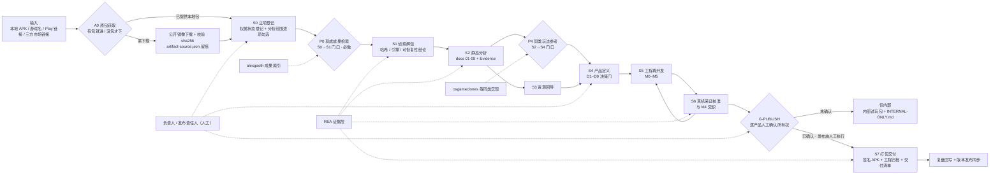

# 架构图（v1.4.3）

> 日期：2026-11-09 ｜ 适用：`apk-rebuild-skills` v1.4.3 ｜ 配套：[SOP.md](SOP.md)、`skills/rebuild-workflow/references/stage-map.md`
>
> 历史版本：2026-09 的 RescueBench 分层架构图 / S0–S9 流程图已归档，仅代表当时的设计，**不作为现行架构依据**（见文末「历史设计包」）。

## 一、分层架构

```mermaid
flowchart TB
    subgraph USE["使用层 · Agent 工具（目录联接安装，git pull 即更新）"]
        U1["WorkBuddy / CodeBuddy"]
        U2["Claude Code / OpenCode"]
        U3["Codex"]
        U4["Trae CN"]
    end

    subgraph CTL["总控层 · rebuild-workflow 1.4.3（唯一自建编排资产）"]
        C0["A0 原包获取（流程第一步）<br/>有包就进 / 没包才下"]
        C1["合规模型：分析放行 / 发布管控"]
        C2["八阶段 S0–S7 + 出口标准 + 七条铁律"]
        C3["决策门 D1–D9（负责人拍板）"]
        C4["P0 / P4 横切检查点（不占阶段编号）"]
        C5["复盘回写 + 版本发布同步"]
    end

    subgraph STG["阶段技能层 · rebuild-*"]
        S12["rebuild-recon<br/>S1–S2 解包 / 静态分析 / docs 01-09"]
        S3["rebuild-asset-recovery<br/>S3 资源回导 + 版权审查"]
        S4["rebuild-product-design<br/>S4 产品文档 / D1–D9 / 品牌"]
        S5["rebuild-dev-milestones<br/>S5 M0–M5 工程再开发"]
        S6["rebuild-device-evidence<br/>S6 ADB 真机采证校准"]
        S7["rebuild-build-release<br/>S7 打包交付 + G-PUBLISH"]
    end

    subgraph HOR["横向能力层 · 按需加载"]
        H1["REA 静态 / 设备 Evidence<br/>rea-integration.md"]
        H2["现成成果检索<br/>prior-art.md · P0 / P4"]
        H3["引擎专节<br/>Godot / RN+Hermes / Unity IL2CPP"]
        H4["外部成果索引 alexgaoth<br/>工具地图 morluto · unity-mcp 试点"]
    end

    subgraph TOOL["工具层 · 现成积木，可替换"]
        T1["jadx / apktool / Ghidra / dnSpyEx"]
        T2["Il2CppDumper / AssetRipper / UnityPy"]
        T3["adb / 视觉模型 / frida（需授权）"]
        T4["Godot / Unity / JDK17 / Android build-tools"]
    end

    subgraph BOARD["工作台层 · 多项目并行（v1.4.2 起 / v1.4.3 自动刷新，横切不改阶段编号）"]
        B1["各项目根 project.json<br/>状态 / 进度 / 卡点 / 下一步"]
        B2["build_dashboard.py 聚合 + 规范检查"]
        B3["dashboard/index.html<br/>卡点置顶 · 一键复制处理提示词"]
        B4["机器观测 collect_signals<br/>文件活动 / 阶段产物 / 待核实提示"]
        B5["定时重建：计划任务 / --watch<br/>每 15 分钟原子写 + 页面自刷新"]
    end

    subgraph OUT["产出层"]
        O1["docs 01-09 基线文档 + 证据链"]
        O2["可维护新工程源码 + cfg 校准值"]
        O3["签名 APK + 交付清单 + 工程归档"]
        O4["INTERNAL-ONLY.md（未过 G-PUBLISH 时）"]
    end

    C0 --> C1
    CTL -. 阶段结束回写状态 .-> B1
    B1 --> B2 --> B3
    B4 --> B2
    B5 -. 每 15 分钟触发 .-> B2
    B2 -. signals.json / watch.log .-> B4
    B3 -. 人工接手项目 .-> U1
    U1 --> CTL
    U2 --> CTL
    U3 --> CTL
    U4 --> CTL
    CTL --> STG
    CTL --> HOR
    STG --> TOOL
    HOR --> TOOL
    STG --> OUT
    HOR --> O1
    S7 --> O3
    S7 --> O4
```

**关键说明**

- **工作台层是横切观察者**：只读各项目 `project.json` 生成看板，不判定出口标准、不改阶段编号、不自动关闭卡点、不自动发布；人从看板点「处理提示词」把项目交回 Agent。v1.4.3 起增加机器观测（旁证）与每 15 分钟定时重建，**观测不改写权威状态、产物出现不等于阶段出口达标**。
- **编排层是唯一自建资产**：工具层坏了换工具、模型层换了换 API 配置，总控与阶段 skill 的出口标准不变。
- **横向能力层按需加载**：`references/` 与 `engines/` 由总控按阶段注入上下文，不一次塞满。
- **A0 在流程最前**：本地包直接进 S0，否则由 `fetch_artifact.py` 按游戏名 / Play 链接 / 三方链接下载；它是输入 #1 的前置动作，不占 S 编号，也不改门禁结构。
- **安装方式**：`install/install.ps1` 把 `skills/*` 目录联接到四处 Agent 的 skills 目录；Y 盘共享副本因 NAS 限制走复制模式。
- **改动生效链路**：本机 clone → commit + tag → push GitHub → Y 盘共享副本 → 四处安装点 → 其他工作区副本 → 新会话自检（见 `retro-checklist.md` 第 10 条）。只改本地副本不生效。

## 二、端到端流程与人机边界



> 虚线 = 外部输入或人工介入，不占阶段编号。`P0` / `P4` 是可单独灰度、随时摘除的横切检查点。

**人会停下来的地方**（Agent 必须等）

| 位置 | 门禁 | 谁确认 |
|---|---|---|
| **A0** | 游戏名多候选 / 包名版本不符 / 来源可疑 → 人工确认 | 负责人 |
| S0 结束 | scope.md（权属状态 + 授权范围 + P0 结论） | 负责人 |
| S1 结束 | 源码可恢复性结论（R1/R2/R3） | 负责人 |
| S2 结束 | docs/01 + docs/09 | 负责人 |
| S4 | D1–D9 逐门 | 负责人 |
| 每个 M 出口 | 里程碑出口标准 | 负责人 |
| **S7 之前** | **G-PUBLISH：逐产品人工确认所有权，发布由人工执行** | **发布责任人（人工）** |

## 三、合规模型：两条线分开管

| 线 | 从哪到哪 | 规则 | 谁来管 |
|---|---|---|---|
| **分析线**（放行） | S0 → S6 | 所有作品可进入；权属只做四选一状态登记，不阻断开工；分析范围逐项勾选，**没勾 = 不做**；全程安全红线 | Agent 执行，负责人确认门禁 |
| **发布线**（管控） | S7 前 G-PUBLISH → 对外分发 | 逐产品人工确认所有权（凭证 + 确认人 + 日期），**发布动作由人执行**；Agent 禁止自动上架、外发、代填；未确认 → `仅内部` | 发布责任人（人工） |

> 判断口诀：**能不能分析 ≠ 能不能发布**。
> 安全红线（禁止绕过登录 / 风控 / 证书校验、不复用第三方生产服务、不公开发布反编译产物）全程有效，与作品归属无关。
> 外部成果索引命中**不替代** S0 权属登记，更**不替代** G-PUBLISH 人工所有权确认；不把他人对第三方闭源产品的逆向实现搬进交付物。

## 四、外部能力接在哪一层

| 能力 | 定位 | 接入位置 |
|---|---|---|
| `morluto/rea` | 工具本体：静态 / 设备 Evidence | S1 / S2 / S3 / S6 / S7，规则见 `rea-integration.md` |
| `morluto/awesome-reverse-engineering` | 方法论地图：按任务找工具 | `engines/*.md` 工具选型补充 |
| `alexgaoth/awesome-reverse-engineered` | 已逆向成果索引（17,700+） | **P0**，网站 / `npx skills add` / MCP 只读工具 |
| `opengaming/osgameclones` 等 | 同类玩法开源实现 | **P4**，喂给 D5 微创新 |
| `CoplayDev/unity-mcp` | Unity 编辑器自动化（**试点**） | Unity 项目 S5，须在 M0 工具链表登记版本 |

三者定位不混用：**rea = 工具本体 / morluto awesome = 方法论 / alexgaoth = 成果索引**。外部参考标 `external-reference`，不可升级为 `machine-verified`，不可用于关闭 P0 占位。

## 五、仓库结构与架构层对应

| 路径 | 对应层 |
|---|---|
| `skills/rebuild-workflow/scripts/fetch_artifact.py` | A0 原包获取脚本（四种输入，参数化） |
| `skills/rebuild-workflow/references/project-layout.md` | 工作台层规则（目录规范 / project.json schema / 状态回写） |
| `skills/rebuild-workflow/scripts/build_dashboard.py` | 工作台层生成器（离线 HTML 看板 + 机器观测 + `--check` / `--watch` / `--once`） |
| `skills/rebuild-workflow/scripts/install_dashboard_task.ps1` | 工作台层定时器（Windows 计划任务注册 / 查询 / 卸载） |
| `skills/rebuild-workflow/references/dashboard-autorefresh.md` | 工作台层自动刷新规则（两层模型 / 观测字段 / 排查） |
| `templates/project/project.json` | 各项目根状态源模板 |
| `skills/rebuild-workflow/SKILL.md` | 总控层 |
| `skills/rebuild-workflow/references/` | 横向能力层（stage-map / input-checklist / prior-art / rea-integration / engines / retro-checklist） |
| `skills/rebuild-*/SKILL.md` | 阶段技能层（recon / asset-recovery / product-design / dev-milestones / device-evidence / build-release） |
| `skills/*/scripts/` | 工具层封装（参数化、不含路径与密钥） |
| `templates/project/` | S0 输入契约（scope.md / task_spec.yaml / 待优化清单） |
| `docs/SOP.md`、`docs/cases/` | 给人读的流程说明与项目复盘 |
| `install/`、`install/install.ps1` `.sh` | 使用层接入 |
| `tools/lint_skills.py` | 提交前格式 + 密钥扫描 |

## 六、历史设计包（不要拿来当现行架构）

`通用工程/outputs/workbench-design/02-工作台设计规范.md` 中的分层架构图与 **S0–S9** 流水线图，是 2026-09-24 RescueBench 方案的设计冻结稿：

- 该方案已被 `apk-rebuild-skills` 取代，`rescue-bench/` 只作历史存档；
- 旧图的 **S0–S9 十阶段**、授权门禁在 S1、"产物仅限公司自有 APK/EXE" 等表述，均与 v1.4.0 的 **S0–S7 八阶段 + P 横切层 + G-PUBLISH + 分析放行** 不符；
- 查现行架构以本文与 `stage-map.md` 为准。

## 变更记录

- 1.4.3（2026-11-09）工作台层加机器观测节点 B4 与定时重建节点 B5、回写连线；总控版本改 1.4.3；仓库结构表补自动刷新脚本与规则文档。
- 1.4.2（2026-11-09）新增工作台层（project.json 状态源 / build_dashboard.py / 看板 HTML），分层图加节点与回写连线，仓库结构表同步；总控版本改 1.4.2。
- 1.4.1（2026-11-09）入口加 A0 原包获取（本地包 / 游戏名 / Play 链接 / 三方链接），分层图、流程图、门禁表、仓库结构对应表同步。
- 1.4.0（2026-11-09）新建：分层架构图、端到端流程与人机边界图、合规两线模型、外部能力接入位置、仓库结构对应；标注 2026-09 RescueBench 旧图为历史版本。
